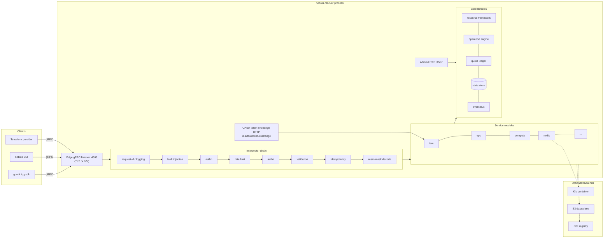
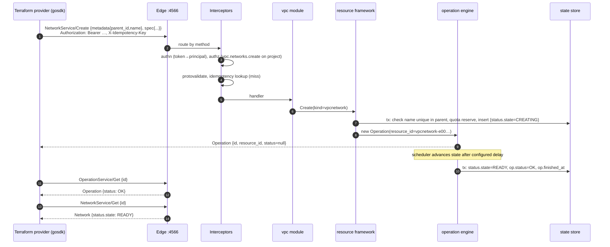

# 02 — System overview

## Concept mapping to LocalStack

LocalStack is our reference architecture. Each LocalStack concept has an equivalent in NebiusMocker:

| LocalStack | NebiusMocker | Notes |
|---|---|---|
| Edge port `4566` serving all services | **Edge listener `:4566`** serving all gRPC services on one port | gRPC routes by full method name (`/nebius.compute.v1.DiskService/Create`), so no host-based routing is needed. The SDK's `"*"` resolver sends every service to one address. |
| `SERVICES=s3,sqs` | `NEBIUS_MOCKER_SERVICES=compute,vpc,iam` | Unlisted services are not registered and return `UNIMPLEMENTED`. |
| Service *providers* (`localstack/services/<svc>/provider.py`) behind a plugin registry | **Service modules** (`services/<area>`) implementing a `Module` interface, registered in a `ServiceRegistry` | See [03](03-repository-layout.md). |
| Lazy service loading | Modules start on first request when `NEBIUS_MOCKER_LAZY=1` | Useful for the all-in-one image. |
| Multi-account / multi-region stores (`AccountRegionBundle`) | **Tenant / project / region scoped stores** | The Nebius hierarchy is tenant → project, and a project belongs to a region ([07](07-state-store.md)). |
| IAM policy enforcement (`ENFORCE_IAM=1`) | `NEBIUS_MOCKER_AUTHZ=enforce\|audit\|off` | [06](06-iam-and-authorization.md) |
| `PERSISTENCE=1`, Cloud Pods (state snapshots) | `NEBIUS_MOCKER_PERSISTENCE=1`, **state snapshots** (export/import via admin API) | [07](07-state-store.md) |
| `/_localstack/health`, `/_localstack/diagnose` | **Admin API** on `:4567` (`/_mocker/health`, `/_mocker/state`, `/_mocker/reset`, …) | HTTP+JSON, separate from the gRPC surface. |
| Init hooks (`/etc/localstack/init/ready.d/*.sh`) | `/etc/nebius-mocker/init/{boot,ready}.d/*` | Shell scripts, or declarative YAML seed files. |
| Chaos API (fault injection) | **Fault injection rules** via admin API | [09](09-quotas-limits-faults.md) |
| EKS emulation runs a real k3s cluster in Docker | `mk8s` **backend modes**: `mock` (default) or `k3s` (real API server in a sibling container) | [services/mk8s.md](../services/mk8s.md) |
| `tflocal` wrapper rewrites provider endpoints | **`tfnebiuslocal`** wrapper plus a ready-made provider override file | [12](12-test-harness.md) |
| Parity / snapshot tests recorded against real AWS | **Parity tests** recorded against a real Nebius tenant, replayed in CI | [12](12-test-harness.md) |

## Components

### Edge listener

A single `grpc.Server` that every enabled module registers on, using the server stubs from
`github.com/nebius/gosdk/proto/...` (`RegisterDiskServiceServer` and the like). It also serves gRPC reflection,
so `grpcurl` works with no proto files, and the standard gRPC health service. Per-service listeners are available for
deployments that want one port per service ([10](10-deployment-topologies.md)).

### Interceptor chain

Unary and stream interceptors that hold all the cross-cutting behavior. See [04](04-request-pipeline.md) for the order
and the contract of each one.

### Service modules

One Go package per Nebius API area (`iam`, `vpc`, `compute`, `mk8s`, …). A module:

- declares its gRPC services, resource kinds, NID prefixes, permissions, quotas and seed data;
- implements the RPC handlers, mostly by configuring the generic resource framework and adding hooks;
- subscribes to events from other modules where needed. For example, `compute` reacts to a `vpc` subnet deletion
  request so it can refuse it while instances still use the subnet.

### Core libraries

| Library | Responsibility |
|---|---|
| **resource framework** | Generic `Get / GetByName / List / Create / Update / Delete` over any proto message with `metadata/spec/status`. Covers NIDs, `resource_version`, timestamps, name uniqueness, immutability, reset-mask patching and paging. |
| **operation engine** | Creates `nebius.common.v1.Operation`s, runs lifecycle transitions on a scheduler, serves `OperationService` for every endpoint, and handles retention. |
| **quota ledger** | Counts usage per (scope, quota name, region). Checks before commit and releases on delete. |
| **state store** | Transactional key-value store for resources, operations, idempotency records, tokens and quota usage. Memory or embedded-disk backends. |
| **event bus** | In-process pub/sub of resource events (`created`, `updated`, `state_changed`, `deleted`). Drives cross-module side effects and `ListOperationsByParent`. |
| **authn / authz** | Token issuance and verification, the permission catalog and the decision engine. |
| **faults** | Matches requests against injection rules and returns errors, latency or dropped operations. |

## A request, end to end

Here `terraform apply` creates a `nebius_vpc_v1_network`:

`OperationService` has no endpoint of its own. Clients call it on the endpoint of the service that started the
operation, so the engine registers it once on the shared edge server. Operation IDs carry the owning service, and every
operation can be resolved no matter which "endpoint" the client believes it is talking to.

## Process model

- **One binary, many modes.** `nebius-mocker` is the all-in-one binary. `nebius-mocker-<area>` binaries are thin
  `main` packages that link a single module. They build the same server with a smaller module set.
- **Cross-module dependencies in split deployments.** When `compute` runs in a container without `vpc` and `iam`,
  it needs remote lookups (does this subnet exist? is this token valid?). Modules reach each other through a
  `Peer` interface. In-process it is a direct call. Across containers it is a **gRPC call to the peer's public API**,
  authenticated with an internal service token. No private protocol is involved, so a split deployment behaves the same
  as all-in-one. See [10](10-deployment-topologies.md#cross-container-dependencies).
