# 08 — Resource lifecycle and the operation engine

## Lifecycle machines

Each resource kind declares a state machine over its `status.state` enum. The enums come from the protos. For example:

| Kind | States in the proto |
|---|---|
| `compute.v1.Instance` | `CREATING, UPDATING, STARTING, RUNNING, STOPPING, STOPPED, DELETING, ERROR` |
| `compute.v1.Disk` | `CREATING, READY, UPDATING, DELETING, ERROR, BROKEN` |
| `mk8s.v1.Cluster` / `NodeGroup` | `PROVISIONING, RUNNING, DELETING` |
| `vpc.v1.Network` / `Subnet` | `CREATING, READY, DELETING` |
| `storage.v1.Bucket` | `CREATING, ACTIVE, UPDATING, SCHEDULED_FOR_DELETION` |
| `registry.v1.Registry` | `CREATING, ACTIVE, DELETING, SUSPENDED` |
| `mysterybox.v1.Secret` | `ACTIVE, SCHEDULED_FOR_DELETION` |

A machine definition:

```go
lifecycle.Machine{
    Field: "status.state",
    Create: lifecycle.Path{
        {State: "CREATING", Duration: timing("compute.instance.create")},
        {State: "STARTING", Duration: timing("compute.instance.start")},
        {State: "RUNNING"}, // terminal for Create → op completes OK
    },
    Update: lifecycle.Path{{State: "UPDATING", Duration: …}, {State: lifecycle.Previous}},
    Delete: lifecycle.Path{{State: "DELETING", Duration: …}, {State: lifecycle.Gone}},
    Verbs: map[string]lifecycle.Path{
        "Stop":  {{State: "STOPPING", Duration: …}, {State: "STOPPED"}},
        "Start": {{State: "STARTING", Duration: …}, {State: "RUNNING"}},
    },
    Guards: map[string][]string{ // verb → allowed current states
        "Stop":  {"RUNNING"},
        "Start": {"STOPPED"},
    },
    OnEnter: map[string]lifecycle.Hook{ // side effects
        "RUNNING": assignIPs,   // fill status.network_interfaces[*].ip_address
    },
}
```

Beyond `state`, modules fill other **synthesized status fields** in `OnEnter` hooks: IP addresses, the mk8s control-plane
endpoint and CA certificate, the bucket's S3 endpoint, registry hostnames, `reconciling` flags and similar.

## Operation engine

```mermaid
stateDiagram-v2
  [*] --> Pending: RPC accepted (status=null, resource locked)
  Pending --> Running: scheduler picks step 1
  Running --> Running: step n → n+1 (status.state updated, progress_tracker advanced)
  Running --> Succeeded: terminal state reached (status=OK, finished_at set, lock released)
  Running --> Failed: hook error / injected fault (status=error+ServiceError; resource → ERROR or rolled back)
  Running --> Aborted: superseded (abort-previous mode)
  Succeeded --> [*]
  Failed --> [*]
  Aborted --> [*]
```



- **Scheduler.** A single goroutine with a min-heap of `(due_time, op_id, step)`, driven by the **mock clock**.
  There are no goroutines per operation. A crash or restart with persistence resumes pending steps from state.
- **Clock.** `clock.Real` by default. The admin API can switch to `clock.Manual` and call `POST /_mocker/clock/advance {"by":"5m"}`.
  Time-based tests (token expiry, the bucket deletion schedule, operation retention) then run instantly and deterministically.
- **Atomicity.** Each step runs in one store transaction that updates the resource and the operation together.
  A client that polls `OperationService.Get` and then `Get` never sees an operation that finished before its resource
  reached the final state.
- **Failure policy.** Per kind: `rollback` (Create failure deletes the resource and releases quota), or `error-state`
  (the resource moves to `ERROR` and stays, as compute does).

### Timing profiles

`NEBIUS_MOCKER_TIMING=instant|fast|realistic` or a file of per-key durations:

| Key (example) | instant | fast (default) | realistic |
|---|---|---|---|
| `vpc.network.create` | 0 (sync op) | 200ms | 3s |
| `compute.disk.create` | 0 | 300ms | 10s |
| `compute.instance.create` | 0 | 1s | 60s ± 20% |
| `mk8s.cluster.create` | 0 | 2s | 8m ± 10% |
| `mk8s.nodegroup.create` | 0 | 2s | 5m |

With `instant`, mutating RPCs return an operation that is **already complete**. The real API allows synchronous
operations, so clients must handle them. This profile is the fastest choice for Terraform CI.

## Cross-resource side effects

Some Nebius resources create or modify others. Modules implement this through the event bus and the peer directory:

| Trigger | Side effect |
|---|---|
| `compute.Instance` Create with `boot_disk.managed_disk` / `secondary_disks[*].managed_disk` | `compute` creates `computedisk` resources owned by the instance and deletes them with it |
| `managed_disk.spec.source_image_family` | Resolve through `ImageService.GetLatestByFamily` (public images project by default) |
| `compute.Instance` network interface with no `allocation_id` | Allocate a private IP from the subnet's pool. The `vpc` module owns address accounting through `AllocationService` semantics |
| `vpc.Network` Create with no pools | Attach the project's default pool, the same as the real `GetDefault`/default-pool behavior |
| `mk8s.Cluster` Delete | Cascade-delete node groups |
| `mk8s.NodeGroup` scale | Create or delete `computeinstance` resources in the node group's project when `NEBIUS_MOCKER_MK8S_MATERIALIZE_NODES=1` (off by default) |
| `iam.ServiceAccount` Delete | Revoke tokens; delete auth public keys, static keys and access keys |
| `storage.Bucket` Delete | Move to `SCHEDULED_FOR_DELETION` and purge after the configured grace period (mock clock) |

## Emulation backends

Following LocalStack (its EKS emulation runs real k3s clusters in Docker), a resource whose value comes from a working
data plane can have a pluggable **backend**:

| Module | `mock` backend (default) | Real backend (opt-in) |
|---|---|---|
| `mk8s` | Plausible endpoint, self-signed CA, kubeconfig that points nowhere useful | `k3s`: starts `rancher/k3s` via the Docker socket for each cluster. The API endpoint and CA in `status` are real, so `kubectl` and the Helm/Kubernetes providers work. Node groups map to k3s agent containers or labels |
| `storage` | Bucket metadata only | Embedded S3 API (`gofakes3`-style) on `:4566/s3`, or proxy to MinIO. Access keys from `iam.v2.AccessKeyService` work as S3 credentials. Enables the Terraform S3 backend guide |
| `registry` | Registry metadata only | Embedded OCI distribution server (`distribution/distribution`), so `docker push` works |
| `kms` | Deterministic fake crypto | Real AES-GCM / RSA / ECDSA with in-memory key material |
| `mysterybox` | Real (payloads are just stored data) | — |
| `compute` | No VM | (later) container-per-instance for cloud-init smoke tests |

Backends implement a small interface per module, and the default is always `mock`. The "real" backends never sit on the
Terraform critical path for M1.
